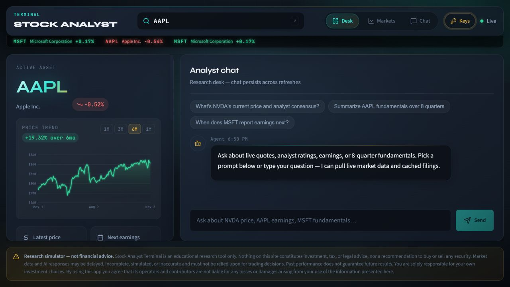
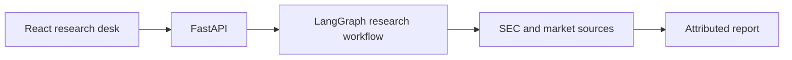

<div align="center">

# 📈 Stock Analyst Agent

**Source-backed equity research through a stateful AI workflow.**

[](backend/)
[](frontend/package.json)

**[Open live project](https://stock-analyst-agent-ashen.vercel.app/)**



<sub>Live research desk after the price chart and analyst data finished loading.</sub>

</div>

---

## 📋 Contents

- [Overview](#-overview)
- [Key Capabilities](#-key-capabilities)
- [Architecture](#-architecture)
- [Tech Stack](#-tech-stack)
- [Getting Started](#-getting-started)
- [Repository Layout](#-repository-layout)
- [Security](#-security)
- [Status](#-status)

---

## 💡 Overview

Full-stack AI research agent that synthesizes SEC 10-K/10-Q filings, historical market pricing, and live analyst sentiment into source-backed equity reports — with every claim traceable to its underlying source.

> **Architecture note:** the core of this project is the **Python backend** — a FastAPI service running a stateful LangGraph agent. The React frontend is a lightweight dashboard for chat, charts, and API key management.


---

## ✨ Key Capabilities

1. **Agent orchestration** — a LangGraph `StateGraph` in `backend/app/agent.py` coordinates stateful tool-calling workflows: the agent plans, calls research tools, and folds results back into shared state between steps.
2. **Grounded research tools** — `backend/app/tools.py` and `backend/app/sources.py` fetch and attribute SEC 10-K/10-Q filings, historical price data, and analyst sentiment. `backend/app/filing_attribution.py` ties each claim in the final report back to its filing source.
3. **Market data pipeline** — daily market snapshots are cached under `data/market/` and refreshed by `scripts/update_market_cache.py`, so the agent isn't hammering external APIs on every query.
4. **LLM routing with fallback** — Groq-first routing (see `frontend/src/utils/llmRouting.js` and `backend/app/config.py`) falls back between providers and handles rate limits gracefully instead of failing mid-research.
5. **BYOK, server-side only** — bring your own API keys; they're validated and stored per-session and never leave the server (`backend/app/security.py`). The frontend never touches a provider directly.

---

## 🏗️ Architecture



---

## 🧱 Tech Stack

| Layer | Tech |
|---|---|
| Agent & backend | Python, FastAPI, LangGraph, Groq (with provider fallback) |
| Frontend | React (JavaScript), custom dashboard components |
| Data | SEC EDGAR filings, cached market pricing, analyst sentiment |
| Infra | Docker, docker-compose, Render (`render.yaml`) |

---

## 🚀 Getting Started

### Local (Windows PowerShell helpers)

```powershell
./start-backend.ps1    # FastAPI backend (see DEPLOY.md for env vars)
./start-frontend.ps1   # React frontend
```

Set your provider API keys in `backend/.env` (see `backend/.env.example`).

### Docker

```bash
docker-compose up --build
```

The repo includes `Dockerfile` (backend), `Dockerfile.web` (frontend), and `render.yaml` for one-click Render deploys — full instructions in [DEPLOY.md](DEPLOY.md).

---

## 📁 Repository Layout

```
backend/
  app/
    agent.py               # LangGraph StateGraph agent orchestration
    main.py                # FastAPI app and routes
    tools.py               # Research tools (filings, pricing, sentiment)
    sources.py             # Source fetching and attribution
    filing_attribution.py  # Maps report claims back to SEC filings
    tickers.py             # Ticker resolution
    security.py            # BYOK key handling, server-side only
    config.py              # Provider routing and configuration
  scripts/
    test_agent.py          # Agent smoke tests
scripts/
  update_market_cache.py   # Market data snapshot refresher
frontend/
  src/
    App.jsx                # React app shell
    components/            # Dashboard, PriceChart, MarketView,
                           # AnalystRatingGauge, ChatBox, ApiKeySettings
    utils/llmRouting.js    # Provider fallback routing
data/
  market/                  # Cached daily + latest market snapshots
```

---

## 🔒 Security

- BYOK credentials are handled strictly server-side and never exposed to the browser
- See [SECURITY.md](SECURITY.md) for reporting and hardening notes

---

## 📌 Status

Built and deployed summer 2026; actively maintained. Contributions and issue reports welcome.

<div align="center">

*Built by [@ZenzerJs](https://github.com/ZenzerJs)*

</div>
